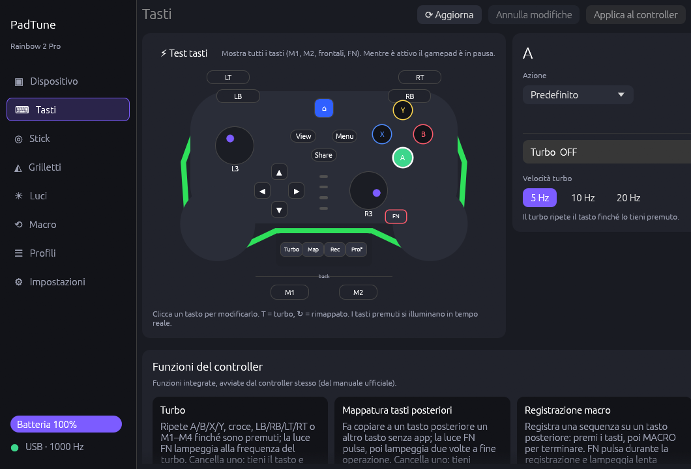

# PadTune

**Configuratore non ufficiale per controller BIGBIG WON® (Rainbow 2 Pro e famiglia) su Linux e Windows** — senza software ufficiale.

[Read in English](README.md)



PadTune è un unico programma in Rust con un'interfaccia grafica
(`padtune-gui`) e uno strumento da riga di comando (`padtune`). Dialoga con
l'interfaccia di configurazione del controller, quindi ogni impostazione resta
**salvata nel controller** e funziona poi su qualsiasi PC o console.

## Funzioni

| | |
|---|---|
| **Tasti** | Rimappa qualsiasi tasto su un altro tasto o su un tasto della tastiera (con modificatori), disattivalo, **turbo** per tasto e velocità del turbo. Clicca il tasto sul disegno del controller. |
| **Stick** | Editor della curva (zona morta, anti zona morta, due punti, limite esterno, uscita massima), preset, tre set di curve, posizione dello stick in tempo reale. |
| **Grilletti** | Inizio della zona morta, punto di pressione piena, hair trigger, corsa in tempo reale. |
| **Luci** | Luminosità della striscia LED, colore del logo HOME con intensità, ritorno ai valori di fabbrica con un clic. |
| **Macro** | Modifica le quattro macro del controller passo per passo (tasti premuti, durata) e associale a M1/M2. |
| **Polling** | Lettura e impostazione a 250 / 500 / 1000 / 2000 Hz. |
| **Dispositivo** | Modello, firmware, seriale, batteria, cavo USB o dongle 2.4G, test tasti (tutti, anche M1/M2, FN e i tasti frontali), backup/ripristino, impostazioni di fabbrica. |
| **Profili** | Salva profili con nome e applicali con un clic — vengono inviate solo le parti cambiate. |
| **Funzioni del controller** | Cosa fa ogni scorciatoia integrata (TURBO, Mapping, MACRO, Configuration, combinazioni con FN, calibrazione, cambio modalità), dal manuale ufficiale. |
| **Desktop** | Icona nella barra di sistema, avvio con il sistema, istanza unica, inglese e italiano. |

## Compatibilità

| Modello | ID USB | Firmware / marker | Profilo | Stato |
|---|---|---|---|---|
| Rainbow 2 Pro (cavo) | `413d:2104` | ZKM 6, `ZJ-C1pro` | `280_v36` | **Provato**: tutto quanto sopra |
| Rainbow 2 Pro (dongle 2.4G) | `413d:2104` | uguale | `280_v36` | Letture provate; test tasti non disponibile via dongle |
| Rainbow 2 SE, Rainbow 3, Blitz2, Gale… | `413d:2104` | altri | `240`–`508` | Stessa famiglia di protocollo, **non provati** — la lettura dovrebbe funzionare; le scritture sono rifiutate per layout di profilo sconosciuti |

Hai un altro modello? Apri una issue con l'output di `padtune list` e
`padtune info` (il modello di issue lo chiede).

## Installazione

### Arch Linux (AUR)

```sh
yay -S padtune        # compila dai sorgenti
yay -S padtune-bin    # binari precompilati
```

Il pacchetto installa la regola udev, così il controller funziona senza root.

### Altre distribuzioni Linux

Scarica `padtune-<versione>-linux-x86_64.tar.gz` dalle
[Release](https://github.com/deddroid/padtune/releases), estrailo ed esegui:

```sh
./install.sh --udev     # installa in ~/.local; --udev aggiunge la regola udev (sudo)
./install.sh --uninstall
```

### Windows

Scarica `padtune-<versione>-windows-x86_64.zip` dalle
[Release](https://github.com/deddroid/padtune/releases), estrailo e avvia
`padtune-gui.exe`. Non servono driver. Gli eseguibili non sono firmati,
quindi SmartScreen può avvisare al primo avvio ("Ulteriori informazioni" →
"Esegui comunque").

### Dai sorgenti

```sh
cargo build --release                       # GUI + CLI
cargo build --release --no-default-features # solo CLI (senza dipendenze grafiche)
```

Su Linux servono `hidapi` (hidraw) e, per la GUI, un driver OpenGL funzionante.

## Uso

Avvia **PadTune** dal menu, oppure `padtune-gui`. Modifica le
impostazioni e premi **Applica al controller**: viene scritto solo ciò che è
cambiato, e ogni scrittura viene verificata rileggendola.

```text
padtune list                      # controller collegati
padtune info                      # modello, firmware, polling, batteria…
padtune profile                   # profilo attuale
padtune backup mio.bin            # salva il profilo
padtune restore mio.bin           # lo riscrive (verificato)
padtune macros                    # slot macro con i loro passi
padtune set polling 1000
padtune set brightness 128        # striscia LED, 0-255
padtune set logo ff0000           # colore logo HOME (000000 = fabbrica)
padtune set trigger left --start 5 --end 90 --hair false
padtune monitor 30                # test tasti: stampa ogni pressione
```

`padtune-gui --hidden` si avvia nella barra di sistema.

### Variabili d'ambiente

| Variabile | Effetto |
|---|---|
| `PADTUNE_DEBUG=1` | Stampa ogni report inviato e ricevuto |
| `PADTUNE_CONFIG_DIR` | Usa un'altra cartella per impostazioni e profili |
| `PADTUNE_STATE` | Usa un altro file di stato (ultima configurazione applicata) |
| `PADTUNE_DEMO=1` | GUI con un Rainbow 2 Pro simulato, senza accesso USB |
| `PADTUNE_SCREENSHOTS=cartella` | Salva uno screenshot di ogni scheda in ogni lingua, poi esce |

Le impostazioni sono in `~/.config/padtune/` (Linux) o `%APPDATA%\padtune\`
(Windows): `settings.toml` (preferenze dell'app), `state.toml` (ultima
configurazione applicata per controller) e `profiles/*.toml`.

## Limiti noti

* Il **test tasti** mette in pausa il gamepad mentre è attivo (è il
  funzionamento del controller) e funziona solo via cavo USB.
* La **configurazione integrata attiva** (i quattro LED bianchi) non è
  leggibile dal controller.
* Il **colore personalizzato della striscia LED** (doppio clic su FN) non è
  ancora impostabile; luminosità e colore del logo HOME sì.
* Le impostazioni di vibrazione e controllo di movimento vengono preservate ma
  non sono ancora modificabili.
* Le versioni Windows sono prodotte dalla CI e non sono state provate
  dall'autore su un PC Windows reale.

Dettagli del protocollo: [docs/PROTOCOL.md](docs/PROTOCOL.md).

## Crediti

* **deddroid** — autore, test sull'hardware.
* **Claude** (Anthropic) — reverse engineering e codice, scritto con deddroid.
* [BlitzForge](https://github.com/tikokuma/BlitzForge) di tikokuma,
  [Better BigBig Won Assistant](https://github.com/XBXSean/-BBBWA-BetterBigBigWonAssistant-) di XBXSean,
  [armorx-toolkit](https://github.com/feshinkof-boop/armorx-toolkit) di feshinkof-boop —
  ricerche sul protocollo su cui si basa questo progetto.
* [REA](https://github.com/morluto/rea) e [Ghidra](https://ghidra-sre.org/) per l'analisi.

## Note legali

PadTune è un progetto indipendente e non ufficiale. **Non è affiliato, approvato
né sponsorizzato da BIGBIG WON** o dal suo produttore. BIGBIG WON, Rainbow e gli
altri nomi di prodotto sono marchi dei rispettivi proprietari e sono usati solo
per indicare con quali controller PadTune funziona.

PadTune non contiene codice, firmware, immagini o altri file del software
ufficiale. Il protocollo è stato ricostruito a fini di interoperabilità,
osservando la comunicazione con il proprio controller e studiando gli strumenti
ufficiali, come consentito a questo scopo (ad esempio dall'articolo 6 della
direttiva UE 2009/24/CE). PadTune non aggiorna mai il firmware. Uso a proprio
rischio: tieni sempre un backup (`padtune backup`).

## Licenza

[MIT](LICENSE)
