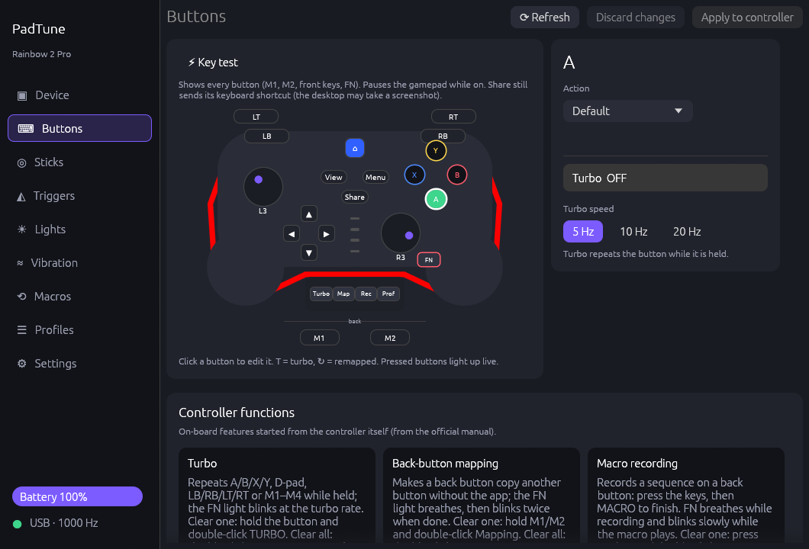

# PadTune

**Unofficial configurator for BIGBIG WON® controllers (Rainbow 2 Pro and family) on Linux and Windows** — no official software needed.

[Leggi in italiano](README.it.md)



PadTune is a single Rust program with a desktop GUI (`padtune-gui`) and a
command line tool (`padtune`). It talks to the controller's own
configuration interface, so every setting is stored **in the controller** and
works on any PC or console afterwards.

## Features

| | |
|---|---|
| **Buttons** | Remap any button to another button or to a keyboard key (with modifiers), disable it, per-button **turbo** and turbo speed. Click the button on a drawing of your controller. |
| **Sticks** | Response curve editor (dead zone, anti-dead zone, two curve points, outer limit, max output), presets, three curve sets, live stick position. |
| **Triggers** | Dead zone start, full-press point, hair trigger, live trigger travel. |
| **Lights** | Light-strip effect (static, breathing, gradient, flicker; speed, brightness, up to 7 colours per side, or synced with the logo), strip brightness, HOME logo colour with intensity, factory defaults with one click. |
| **Macros** | Edit the four on-board macros step by step (buttons held, duration), bind them to M1/M2. |
| **Polling rate** | Read and set 250 / 500 / 1000 / 2000 Hz. |
| **Device** | Model, firmware, serial, battery, USB cable vs 2.4G dongle, key test (every button including M1/M2, FN and the front keys), backup/restore, factory settings. |
| **Profiles** | Save named profiles and apply them with one click — only the parts that changed are sent. |
| **Controller functions** | What every on-board shortcut does (TURBO, Mapping, MACRO, Configuration, FN combos, calibration, mode switch), from the official manual. |
| **Desktop** | Tray icon, start with the system, single instance, English and Italian. |

## Compatibility

| Model | USB ID | Firmware / marker | Profile | Status |
|---|---|---|---|---|
| Rainbow 2 Pro (cable) | `413d:2104` | ZKM 6, `ZJ-C1pro` | `280_v36` | **Tested**: everything above |
| Rainbow 2 Pro (2.4G dongle) | `413d:2104` | same | `280_v36` | Reads tested; key test not available over the dongle |
| Rainbow 2 SE, Rainbow 3, Blitz2, Gale… | `413d:2104` | other | `240`–`508` | Same protocol family, **untested** — reading should work; writes are refused for unknown profile layouts |

Have another model? Open an issue with the output of `padtune list` and
`padtune info` (the issue template asks for it).

## Install

### Arch Linux (AUR)

```sh
yay -S padtune        # builds from source
yay -S padtune-bin    # prebuilt binaries
```

The package installs the udev rule, so the controller works without root.

### Other Linux distributions

Download `padtune-<version>-linux-x86_64.tar.gz` from
[Releases](https://github.com/deddroid/padtune/releases), extract it and run:

```sh
./install.sh --udev     # installs in ~/.local; --udev adds the udev rule (sudo)
./install.sh --uninstall
```

### Windows

Download `padtune-<version>-windows-x86_64.zip` from
[Releases](https://github.com/deddroid/padtune/releases), extract it and
run `padtune-gui.exe`. No driver is needed. The executables are not signed,
so SmartScreen may warn on first launch ("More info" → "Run anyway").

### From source

```sh
cargo build --release                       # GUI + CLI
cargo build --release --no-default-features # CLI only (no GUI dependencies)
```

Linux needs `hidapi` (hidraw) and, for the GUI, a working OpenGL driver.

## Usage

Start **PadTune** from the menu, or `padtune-gui`. Edit the
settings, then press **Apply to controller**: only what changed is written,
and every write is verified by reading it back.

```text
padtune list                      # connected controllers
padtune info                      # model, firmware, polling, battery…
padtune profile                   # current profile
padtune backup my.bin             # save the profile
padtune restore my.bin            # write it back (verified)
padtune macros                    # macro slots with their steps
padtune set polling 1000
padtune set brightness 128        # light strip, 0-255
padtune set logo ff0000           # HOME logo colour (000000 = factory)
padtune set strip --effect breathing --colors 0000ff,ff0000 --speed 128
padtune set trigger left --start 5 --end 90 --hair false
padtune monitor 30                # key test: prints every button press
```

`padtune-gui --hidden` starts in the tray.

### Environment variables

| Variable | Effect |
|---|---|
| `PADTUNE_DEBUG=1` | Print every report sent and received |
| `PADTUNE_CONFIG_DIR` | Use another settings/profiles directory |
| `PADTUNE_STATE` | Use another state file (last applied configuration) |
| `PADTUNE_DEMO=1` | GUI with a built-in Rainbow 2 Pro, no USB access |
| `PADTUNE_SCREENSHOTS=dir` | Save a screenshot of every tab in every language, then exit |
| `PADTUNE_TEST_CLOSE_AFTER=s` | Close the window after `s` seconds (tray behaviour tests) |

Settings live in `~/.config/padtune/` (Linux) or `%APPDATA%\padtune\`
(Windows): `settings.toml` (app preferences), `state.toml` (last
configuration applied per controller) and `profiles/*.toml`.

## Known limitations

* The **key test** pauses the gamepad while it is on (the controller works
  that way) and only works over the USB cable.
* The **active on-board configuration** (the four white LEDs) cannot be read
  from the controller.
* The **light-strip effect** is shown when the strip is in "custom light"
  mode (double-click FN on the controller). It cannot be read back from the
  controller, so PadTune shows the last effect it applied.
* Vibration and motion-control settings are kept untouched but not editable yet.
* Windows builds are produced by CI and have not been tested on a real
  Windows machine by the author.

Protocol details: [docs/PROTOCOL.md](docs/PROTOCOL.md).

## Credits

* **deddroid** — author, hardware testing.
* **Claude** (Anthropic) — reverse engineering and code, written with deddroid.
* [BlitzForge](https://github.com/tikokuma/BlitzForge) by tikokuma,
  [Better BigBig Won Assistant](https://github.com/XBXSean/-BBBWA-BetterBigBigWonAssistant-) by XBXSean,
  [armorx-toolkit](https://github.com/feshinkof-boop/armorx-toolkit) by feshinkof-boop —
  protocol research this project builds on.
* [REA](https://github.com/morluto/rea) and [Ghidra](https://ghidra-sre.org/) for the analysis.

## Legal

PadTune is an independent, unofficial project. It is **not affiliated with,
endorsed or sponsored by BIGBIG WON** or its manufacturer. BIGBIG WON, Rainbow
and other product names are trademarks of their respective owners and are used
here only to say which controllers PadTune works with.

PadTune contains no code, firmware, images or other files from the official
software. The protocol was worked out for interoperability, by observing the
communication with the user's own controller and by studying the official
tools, as permitted for that purpose (for example by Article 6 of EU Directive
2009/24/EC). PadTune never updates firmware. Use it at your own risk: always
keep a backup (`padtune backup`).

## License

[MIT](LICENSE)
